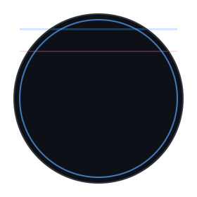

<h2 align="center">Hi, I'm Davide! </h2>
<h3 align="center">Level 18 System Architect | Tech Lead | Mentor Oath</h3>

<p align="center">
  
</p>

<p align="center">
  
</p>

<p align="center">
  
  
  
  
</p>

<p align="center">
  <a href="http://www.accenture.com"></a>
  <a href="https://coderdojo.com/it-IT"></a>
</p>

<p align="center">
  <a href="https://twitter.com/davidemaggi"></a>
  <a href="https://www.linkedin.com/in/davidemaggi/"></a>
  <a href="https://github.com/davidemaggi"></a>
</p>

## Character Card

```yaml
Name: Davide
Class: Architect / Tech Lead
Background: Builder-Mentor
Alignment: Chaotic Good
Special Move: "Turn uncertainty into clear architecture"
Weapon of Choice: "Whiteboard + markers + uncomfortable questions"
```

## Ability Scores

| Attribute | Score | Modifier | Flavor |
|---|---:|---:|---|
| INT (Systems Thinking) | 20 | +5 | Turns complexity into diagrams |
| WIS (Trade-offs) | 18 | +4 | Knows when "it depends" is the right answer |
| CHA (Mentoring) | 17 | +3 | Explains hard things without jargon fog |
| CON (Production Incidents) | 16 | +3 | Survives late-night boss fights |
| DEX (Delivery) | 15 | +2 | Ships without panic |
| STR (Legacy Refactors) | 14 | +2 | Carries old codebases uphill |

## Proficiencies

- `Architecture`: ██████████ 10/10
- `Programming`: █████████░ 9/10
- `Debugging under pressure`: ██████████ 10/10
- `Mentorship & leadership`: █████████░ 9/10
- `Sleep after release day`: █░░░░░░░░░ 1/10

## Spellbook (Equipped Stack)

<p align="left">
  
  
  
  
  
  
  
  
  
  
  
  
  
  
</p>

## Quest Log

- [x] Build systems that survive Monday morning traffic.
- [x] Mentor new adventurers through practical engineering.
- [ ] Defeat the ancient dragon: "It works on my machine."
- [ ] Long rest (rare legendary event).

## Random Encounter Table (d20)

```text
1-5   Unexpected requirement from another realm
6-10  CI pipeline trap detected and disarmed
11-15 Legacy monolith demands a tribute
16-19 Team unlocks smooth deploy streak
20    Critical bug fixed before anyone notices
```

## Co-op Mode

If you want to party up on software architecture, technical leadership, mentoring, or emerging tech, reach out on [LinkedIn](https://www.linkedin.com/in/davidemaggi/) or [X/Twitter](https://twitter.com/davidemaggi).  
No NPC replies. Human-to-human only.

